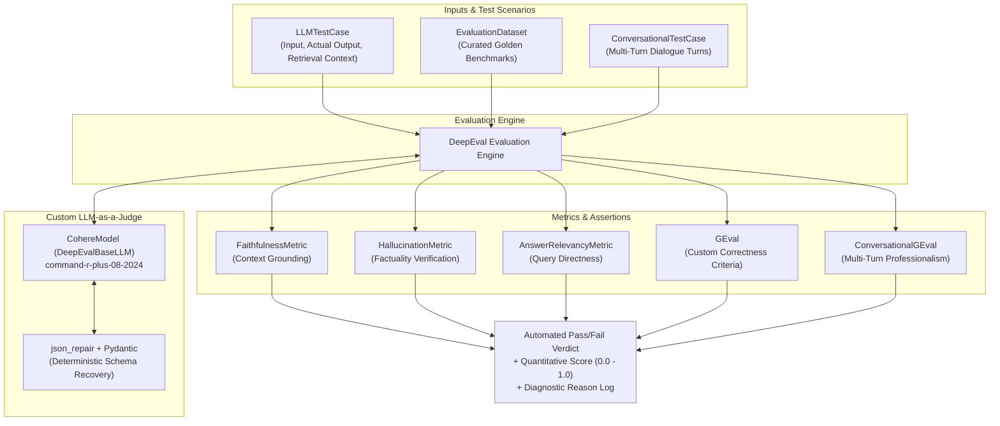

# DeepEval LLM Testing Suite

[](https://www.python.org/downloads/)
[](https://confident-ai.com/)
[](https://cohere.com/)
[](https://pytest.org/)
[](https://opensource.org/licenses/MIT)

An enterprise-ready **Automated Testing & Quality Assurance Suite for Large Language Models** built with **DeepEval**, **Pytest**, and a custom **Cohere LLM-as-a-Judge** adapter.

This repository demonstrates how to implement unit testing, regression testing, and CI/CD quality gates for generative AI applications—evaluating factual faithfulness, hallucination rates, answer relevancy, G-Eval criteria, and multi-turn conversational professionalism.

---

## Evaluation Architecture



---

## Test Suite Catalog

| Test File | Metric / Component | Evaluator Judge | Evaluation Scope |
|---|---|---|---|
| [`src/cohere_evalmodel.py`](src/cohere_evalmodel.py) | **Custom LLM Judge Adapter** | `command-r-plus-08-2024` | Extends `DeepEvalBaseLLM`, handles schema extraction, and uses `json_repair` for robust JSON parsing. |
| [`tests/test_01_faithfulness.py`](tests/test_01_faithfulness.py) | **`FaithfulnessMetric`** | Cohere Judge | Measures whether output claims are strictly derived from and supported by the retrieval context. |
| [`tests/test_02_hallucination_and_geval.py`](tests/test_02_hallucination_and_geval.py) | **`HallucinationMetric` & `GEval`** | Cohere Judge | Tests for ungrounded hallucinated assertions and enforces custom LLM correctness criteria via `assert_test`. |
| [`tests/test_03_answer_relevancy.py`](tests/test_03_answer_relevancy.py) | **`AnswerRelevancyMetric`** | Cohere Judge | Evaluates the ratio of relevant sentences to total statements, penalizing off-topic rambling. |
| [`tests/test_04_golden_dataset.py`](tests/test_04_golden_dataset.py) | **`EvaluationDataset` & `Golden`** | Cohere Judge | Runs regression benchmark tests comparing model responses against verified reference answers. |
| [`tests/test_05_conversational_geval.py`](tests/test_05_conversational_geval.py) | **`ConversationalGEval`** | Cohere Judge | Evaluates multi-turn role-based dialogues (`ConversationalTestCase`) for professionalism and polite tone. |
| [`tests/test_06_live_chatbot_evaluation.py`](tests/test_06_live_chatbot_evaluation.py) | **Live Chatbot Multi-Turn** | Cohere Judge | Conducts real-time stateful chat sessions with Cohere models and verifies conversation professionalism. |

---

## Custom LLM Judge: `CohereModel`

DeepEval by default relies on OpenAI. This repository implements a custom, fully compliant `DeepEvalBaseLLM` class that routes evaluation tasks to Cohere's flagship reasoning model (`command-r-plus-08-2024`):

```python
from deepeval.models import DeepEvalBaseLLM
from json_repair import repair_json
import cohere

class CohereModel(DeepEvalBaseLLM):
    def __init__(self, model="command-r-plus-08-2024"):
        self.client = cohere.ClientV2(api_key=os.getenv("COHERE_API_KEY"))
        self.model = model

    def generate(self, prompt: str, schema: BaseModel = None):
        # Calls Cohere and uses json_repair to guarantee schema adherence
        ...
```

---

## Project Structure

```text
LLM-deepeval-llm-testing/
├── .env.example                               # Environment template
├── .gitignore                                 # Git ignore patterns
├── LICENSE                                    # MIT License
├── README.md                                  # Repository documentation
├── requirements.txt                           # Production dependencies
├── src/
│   ├── __init__.py
│   └── cohere_evalmodel.py                    # Custom DeepEvalBaseLLM implementation
└── tests/
    ├── test_01_faithfulness.py                # Context faithfulness test
    ├── test_02_hallucination_and_geval.py     # Hallucination & custom G-Eval criteria
    ├── test_03_answer_relevancy.py            # Answer relevancy metric test
    ├── test_04_golden_dataset.py              # Golden dataset regression test
    ├── test_05_conversational_geval.py        # Multi-turn conversation professionalism test
    ├── test_06_live_chatbot_evaluation.py     # Live multi-scenario chatbot audit
    └── test_libraries.py                      # Sanity import verification test
```

---

## Getting Started

### 1. Prerequisites
- Python 3.10+
- A Cohere API key ([Cohere Dashboard](https://dashboard.cohere.com/api-keys))

### 2. Installation

```bash
# Clone the repository
git clone https://github.com/<your-username>/LLM-deepeval-llm-testing.git
cd LLM-deepeval-llm-testing

# Create and activate virtual environment
python -m venv .venv

# Windows:
.venv\Scripts\activate
# Linux/macOS:
source .venv/bin/activate

# Install dependencies
pip install -r requirements.txt
```

### 3. Environment Configuration

```bash
cp .env.example .env
```

Add your Cohere API key to `.env`:
```env
COHERE_API_KEY=your_actual_cohere_api_key_here
```

---

## Running the Tests

You can execute tests either via **pytest**, **deepeval CLI**, or directly as standalone **Python scripts**:

### Option A: Using Pytest
```bash
pytest tests/ -v -s
```

### Option B: Using DeepEval CLI (with detailed telemetry and tables)
```bash
deepeval test run tests/test_02_hallucination_and_geval.py
```

### Option C: Direct Python Execution
```bash
# 1. Faithfulness test
python tests/test_01_faithfulness.py

# 2. Hallucination & G-Eval test
python tests/test_02_hallucination_and_geval.py

# 3. Answer Relevancy test
python tests/test_03_answer_relevancy.py

# 4. Golden Dataset Benchmark test
python tests/test_04_golden_dataset.py

# 5. Conversational Professionalism test
python tests/test_05_conversational_geval.py

# 6. Live Chatbot Multi-Turn Evaluation
python tests/test_06_live_chatbot_evaluation.py
```

---

## Sample Test Output

```text
========================================================================================
Running test_hallucination_and_correctness...
========================================================================================

Metric: GEval (Correctness)
Score: 1.0
Success: True
Reason: The model accurately states that there are seven colors in a rainbow matching the expected ground truth.

Metric: HallucinationMetric
Score: 1.0
Success: True
Reason: All entities and factual assertions in the output are grounded in the provided context.

PASSED [100%]
```

---

## License
Distributed under the [MIT License](LICENSE).
